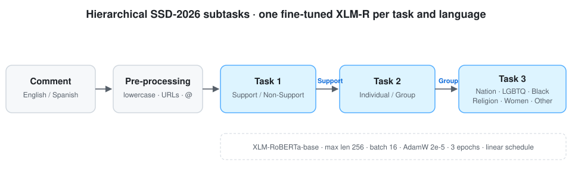

<div align="center">

# MentalAI · Social Support Detection
### Multilingual Social Support Detection and Community Identification with XLM-RoBERTa

[](https://ceur-ws.org/Vol-4273/SSD-2026_paper15.pdf)
[](https://www.codabench.org/competitions/13598/)
[](#installation)
[](LICENSE)
[](https://github.com/marif561/MentalAI-Dpression/actions/workflows/tests.yml)

Code and results for **"SSD-2026 Shared Task: Multilingual Social Support Detection and Community Identification Using XLM-RoBERTa"**, IberLEF 2026 (CEUR-WS Vol-4273).

**Muhammad Arif**¹ · Muhammad Tayyab Zamir² · Samah Fodeh¹ · Moein Shahiki Tash²

¹ Yale University · ² Centro de Investigación en Computación (CIC), Instituto Politécnico Nacional, Mexico

</div>

---

## Overview

Social support — empathy, encouragement, advice, solidarity — is linked to better mental-health outcomes, and much of it now happens in social-media comments. The [SSD-2026 shared task](https://www.codabench.org/competitions/13598/) asks systems to find it automatically in **English and Spanish**, through three hierarchical subtasks:

| Subtask | Question | Labels |
|---|---|---|
| **Task 1** — Support detection | Does the comment express support? | `Support` · `Non-Support` |
| **Task 2** — Target type | Is the support aimed at a person or a group? | `Individual` · `Group` |
| **Task 3** — Targeted community | Which community receives the support? | `Nation` · `LGBTQ` · `Black Community` · `Religion` · `Women` · `Other` |

We fine-tune a separate **XLM-RoBERTa-base** classifier for each subtask and language, using one shared preprocessing pipeline and training configuration.

<p align="center">
  
</p>

## Results

Per-class scores reported in the paper. Macro-F1 is the official shared-task metric; the macro-F1 column is the unweighted mean of the per-class F1 values below.

### Task 1 — Support detection

| Language | Class | Precision | Recall | F1 | Macro-F1 |
|---|---|:-:|:-:|:-:|:-:|
| English | Non-Support | 0.9156 | 0.9741 | **0.9332** | **0.8288** |
| | Support | 0.8542 | 0.6454 | 0.7244 | |
| Spanish | Non-Support | 0.9321 | 0.9241 | **0.9145** | **0.8084** |
| | Support | 0.7183 | 0.6987 | 0.7022 | |

### Task 2 — Target type

| Language | Class | Precision | Recall | F1 | Macro-F1 |
|---|---|:-:|:-:|:-:|:-:|
| English | Group | 0.8132 | 0.6662 | **0.7112** | **0.5411** |
| | Individual | 0.5752 | 0.3214 | 0.3709 | |
| Spanish | Group | 0.7037 | 0.5937 | 0.6319 | **0.6476** |
| | Individual | 0.8217 | 0.5778 | **0.6633** | |

### Task 3 — Targeted community

| Class | EN P | EN R | EN F1 | ES P | ES R | ES F1 |
|---|:-:|:-:|:-:|:-:|:-:|:-:|
| Nation | 0.8421 | 0.8000 | 0.8205 | 0.8537 | 0.8182 | 0.8356 |
| LGBTQ | 0.8857 | 0.8158 | 0.8493 | 0.8947 | 0.8293 | 0.8608 |
| Black Community | 0.7917 | 0.7600 | 0.7755 | 0.8049 | 0.7674 | 0.7857 |
| Religion | 0.8679 | 0.8483 | **0.8580** | 0.8750 | 0.8537 | **0.8642** |
| Women | 0.8214 | 0.7667 | 0.7931 | 0.8348 | 0.7872 | 0.8103 |
| Other | 0.7684 | 0.7290 | 0.7482 | 0.7812 | 0.7463 | 0.7634 |
| **Macro-F1** | | | **0.8074** | | | **0.8200** |

**Takeaways**

- Task 3 is the strongest subtask: Religion, LGBTQ and Nation have distinctive vocabulary; the heterogeneous `Other` class is hardest.
- In Task 1 the minority `Support` class has much lower recall (0.65 EN / 0.70 ES) — implicit or indirect support is easy to miss.
- Task 2 is the hardest, especially English `Individual` targets (recall 0.32), which need entity and context resolution rather than lexical cues.

CSV copies of every table are in [`results/`](results/).

## Repository structure

```
.
├── configs/xlmr.yaml        # Hyperparameters from the paper (Table 1)
├── data/                    # Expected data format + tiny invented samples
├── docs/figures/            # Framework diagram
├── results/                 # Paper results as CSV
├── scripts/run_all.sh       # Train all 3 subtasks × 2 languages
├── tests/                   # Unit tests (CI on every push)
└── src/ssd/
    ├── data.py              # CSV loading, label mapping, task filtering
    ├── preprocess.py        # Text cleaning pipeline (Section 3.2)
    ├── metrics.py           # Precision / recall / F1, macro- and weighted-F1
    ├── train.py             # Fine-tune XLM-R for one subtask
    └── predict.py           # Run a trained model on new comments
```

## Installation

```bash
git clone https://github.com/marif561/MentalAI-Dpression.git
cd MentalAI-Dpression
python -m venv .venv && source .venv/bin/activate
pip install -r requirements.txt
pip install -e .
```

## Data

The SSD-2026 data is distributed by the organisers through [Codabench](https://www.codabench.org/competitions/13598/) and is **not** included here. Download it there, then point the scripts at your CSV files. Column names are configurable; see [`data/README.md`](data/README.md).

## Usage

```bash
# Task 1 (support detection), English
python -m ssd.train --task 1 --lang en \
  --train data/en/train.csv --dev data/en/dev.csv --test data/en/test.csv \
  --text-col text --label-col label

# Task 2 (target type) and Task 3 (community) work the same way
python -m ssd.train --task 3 --lang es --train data/es/train.csv --dev data/es/dev.csv

# All subtasks and languages
bash scripts/run_all.sh data

# Predict with a trained model
python -m ssd.predict --model outputs/task1_en/model --input new_comments.csv --output preds.csv
```

Each run writes the fine-tuned model, a classification report (`metrics.json`) and test-set predictions to `outputs/task{N}_{lang}/`.

**Training configuration** (paper Table 1): XLM-RoBERTa-base · max length 256 · batch 16 · AdamW, lr 2e-5 · 3 epochs · dropout 0.1 · weight decay 0.01 · linear schedule.

> **Note.** `src/` is a clean reference implementation of the setup described in the paper. Scores can differ slightly from the reported ones depending on data splits, hardware, library versions and seeds.

## Citation

```bibtex
@inproceedings{arif2026ssd,
  title     = {{SSD-2026} Shared Task: Multilingual Social Support Detection and Community Identification Using {XLM-RoBERTa}},
  author    = {Arif, Muhammad and Zamir, Muhammad Tayyab and Fodeh, Samah and Shahiki Tash, Moein},
  booktitle = {Proceedings of the Iberian Languages Evaluation Forum (IberLEF 2026)},
  series    = {CEUR Workshop Proceedings},
  volume    = {4273},
  year      = {2026},
  url       = {https://ceur-ws.org/Vol-4273/SSD-2026_paper15.pdf}
}
```

Please also cite the task overview: Shahiki Tash et al., *Overview of SSD-2026 at IberLEF 2026: Social Support Detection*, IberLEF 2026.

## Contact

Muhammad Arif — muhammad.arif@yale.edu · Samah Fodeh (corresponding) — samah.fodeh@yale.edu

## License

Code is released under the [MIT License](LICENSE). The paper is published under CC BY 4.0. The SSD-2026 dataset is subject to the organisers' terms.
